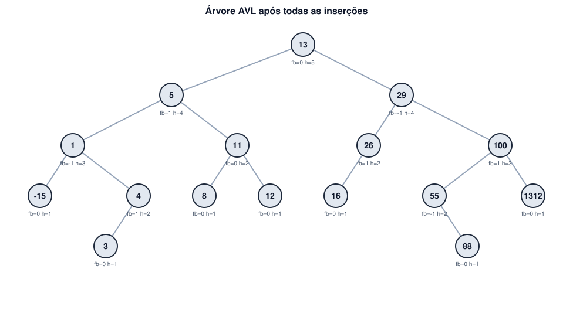
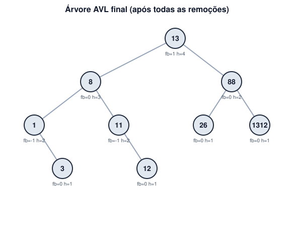

# Árvore AVL — Inserção, Balanceamento e Remoção

Implementação em Python de uma **Árvore AVL** (BST que se auto-balanceia),
com a sequência de inserções e remoções abaixo, **log completo dos cálculos**
de fator de balanceamento (FB) e **diagramas** gerados automaticamente a
cada passo.

**Inserir:** `55, 26, 29, 13, 12, 11, 16, 1, 5, 29, -15, 4, 16, 8, 4, 5, 3, 1312, 100, 88`

**Remover:** `4, 29, 100, 5, -15, 16, 55`

> Todo o resultado abaixo (cálculos e imagens) é gerado automaticamente ao
> rodar `python3 main.py` — nada foi desenhado "na mão". O código está em
> [`avl_tree.py`](avl_tree.py), o gerador de diagramas em
> [`svg_render.py`](svg_render.py), e o log bruto completo (todas as 20
> inserções + 7 remoções, passo a passo) está em [`log.txt`](log.txt).

---

## 1. Conceito: o que é balancear uma AVL

Uma árvore AVL é uma BST em que, para **todo** nó, a diferença de altura
entre as subárvores esquerda e direita nunca passa de 1. Essa diferença é o
**Fator de Balanceamento**:

```
FB(nó) = altura(filho_esquerdo) − altura(filho_direito)
```

Convenção usada aqui: `altura(None) = 0`, `altura(folha) = 1`.

Depois de toda inserção ou remoção, subimos pelo caminho de ancestrais do
nó alterado recalculando `FB`. Se algum nó fica com `|FB| > 1`, a árvore
está desbalanceada ali e aplicamos uma **rotação**:

| Condição | Caso | Correção |
|---|---|---|
| `FB(nó) > 1` e `FB(filho esquerdo) ≥ 0` | **LL** (esquerda-esquerda) | 1 rotação à **direita** no nó |
| `FB(nó) > 1` e `FB(filho esquerdo) < 0` | **LR** (esquerda-direita) | rotação à esquerda no filho esquerdo, depois rotação à direita no nó |
| `FB(nó) < -1` e `FB(filho direito) ≤ 0` | **RR** (direita-direita) | 1 rotação à **esquerda** no nó |
| `FB(nó) < -1` e `FB(filho direito) > 0` | **RL** (direita-esquerda) | rotação à direita no filho direito, depois rotação à esquerda no nó |

**Rotação à direita** em `y` (com filho esquerdo `x`): `x` sobe, `y` vira
filho direito de `x`, e a subárvore direita de `x` (se houver) vira a
subárvore esquerda de `y`. Rotação à esquerda é o espelho disso.

**Duplicatas:** uma BST não admite chaves repetidas. Os valores `29`, `16`,
`4` e `5` aparecem duas vezes na lista de entrada — a 2ª ocorrência de cada
um é **ignorada** na inserção (o código detecta e registra isso no log).

---

## 2. Fase 1 — Inserções

Inseri os 20 valores, um de cada vez, recalculando FB dos ancestrais após
cada inserção. **5 inserções** dispararam rotação. Os outros 15 passos só
precisaram recalcular alturas/FB sem desbalancear nada (diagrama de cada um
dos 20 passos está em [`diagrams/insert_01_55.svg`](diagrams/insert_01_55.svg)
… [`insert_20_88.svg`](diagrams/insert_20_88.svg)).

### 2.1 Rotação ao inserir `29` (3ª inserção) — caso LR

Antes: `55 → 26 → 29` (29 é filho direito de 26, que é filho esquerdo de 55).

```
nó 26: altura(esq=-)=0, altura(dir=29)=1  =>  FB(26) = 0 - 1 = -1
nó 55: altura(esq=26)=2, altura(dir=-)=0  =>  FB(55) = 2 - 0 = 2
```

`FB(55) = 2 > 1` e o filho esquerdo (26) tem `FB = -1 < 0` → **caso LR**:

1. Rotação à **esquerda** em 26 → 29 sobe, 26 vira filho esquerdo de 29.
2. Rotação à **direita** em 55 → 29 sobe para a raiz, 55 vira filho direito de 29.

Resultado: `29` como raiz, `26` à esquerda, `55` à direita — árvore perfeitamente
balanceada (`FB=0` em todos).

### 2.2 Rotação ao inserir `12` (5ª inserção) — caso LL

```
nó 13: altura(esq=12)=1, altura(dir=-)=0  =>  FB(13) = 1 - 0 = 1
nó 26: altura(esq=13)=2, altura(dir=-)=0  =>  FB(26) = 2 - 0 = 2
```

`FB(26) = 2` e o filho esquerdo (13) tem `FB = 1 ≥ 0` → **caso LL**: 1
rotação à **direita** em 26 (13 sobe, 26 desce para a direita de 13).

### 2.3 Rotação ao inserir `11` (6ª inserção) — caso LL

```
nó 12: altura(esq=11)=1, altura(dir=-)=0  =>  FB(12) = 1 - 0 = 1
nó 13: altura(esq=12)=2, altura(dir=26)=1  =>  FB(13) = 2 - 1 = 1
nó 29: altura(esq=13)=3, altura(dir=55)=1  =>  FB(29) = 3 - 1 = 2
```

`FB(29) = 2` e filho esquerdo (13) com `FB = 1 ≥ 0` → **caso LL**: rotação à
direita em 29 (13 sobe à raiz, 29 desce para a direita de 13, e a
subárvore `26` é realocada como filho esquerdo de 29).

### 2.4 Rotação ao inserir `4` (12ª inserção) — caso LR (dupla)

```
nó 5:  altura(esq=4)=1,   altura(dir=-)=0   =>  FB(5)  = 1 - 0 = 1
nó 1:  altura(esq=-15)=1, altura(dir=5)=2   =>  FB(1)  = 1 - 2 = -1
nó 11: altura(esq=1)=3,   altura(dir=12)=1  =>  FB(11) = 3 - 1 = 2
```

`FB(11) = 2` e filho esquerdo (1) com `FB = -1 < 0` → **caso LR**:

1. Rotação à esquerda em 1 → 5 sobe, 1 desce para a esquerda de 5 (a
   subárvore `4` é realocada como filho direito de 1).
2. Rotação à direita em 11 → 5 sobe para o lugar de 11.

### 2.5 Rotação ao inserir `100` (19ª inserção) — caso RL

```
nó 1312: altura(esq=100)=1, altura(dir=-)=0    =>  FB(1312) = 1 - 0 = 1
nó 55:   altura(esq=-)=0,   altura(dir=1312)=2  =>  FB(55)   = 0 - 2 = -2
```

`FB(55) = -2` e filho direito (1312) com `FB = 1 > 0` → **caso RL**:

1. Rotação à direita em 1312 → 100 sobe, 1312 desce para a direita de 100.
2. Rotação à esquerda em 55 → 100 sobe, 55 desce para a esquerda de 100.

### 2.6 Árvore final após as 20 inserções

```
In-order:        [-15, 1, 3, 4, 5, 8, 11, 12, 13, 16, 26, 29, 55, 88, 100, 1312]
Altura da árvore: 5
```



```
              ┌── 1312 (fb=0, h=1)
          ┌── 100 (fb=1, h=3)
          │   │   ┌── 88 (fb=0, h=1)
          │   └── 55 (fb=-1, h=2)
      ┌── 29 (fb=-1, h=4)
      │   └── 26 (fb=1, h=2)
      │       └── 16 (fb=0, h=1)
      13 (fb=0, h=5)                <- raiz
      │       ┌── 12 (fb=0, h=1)
      │   ┌── 11 (fb=0, h=2)
      │   │   └── 8 (fb=0, h=1)
      └── 5 (fb=1, h=4)
          │   ┌── 4 (fb=1, h=2)
          │   │   └── 3 (fb=0, h=1)
          └── 1 (fb=-1, h=3)
              └── -15 (fb=0, h=1)
```

Todos os FB estão em `{-1, 0, 1}` → propriedade AVL satisfeita. ✅

---

## 3. Fase 2 — Remoções

Remoção em BST tem 3 casos por nó: **folha** (remove direto), **um filho**
(o filho assume o lugar) e **dois filhos** (substitui pelo **sucessor
in-order** = menor valor da subárvore direita, e remove o sucessor de lá).
Depois, assim como na inserção, recalculamos FB subindo pelos ancestrais.

| # | Remover | Caso | Sucessor usado | FB recalculados (ancestrais) | Rotação? |
|---|---|---|---|---|---|
| 1 | `4` | 1 filho (só `3` à esquerda) | — | FB(1)=0, FB(5)=0, FB(13)=-1 | não |
| 2 | `29` | 2 filhos | `55` | FB(100)=0, FB(55)=0, FB(13)=0 | não |
| 3 | `100` | 2 filhos | `1312` | FB(1312)=1, FB(55)=0, FB(13)=0 | não |
| 4 | `5` | 2 filhos | `8` | FB(11)=-1, FB(8)=0, FB(13)=0 | não |
| 5 | `-15` | folha | — | FB(1)=-1, FB(8)=0, FB(13)=0 | não |
| 6 | `16` | folha | — | FB(26)=0, FB(55)=-1, FB(13)=0 | não |
| 7 | `55` | 2 filhos | `88` | FB(1312)=0, FB(88)=0, FB(13)=1 | não |

Nenhuma das 7 remoções desbalanceou a árvore (todo FB recalculado ficou
em `{-1, 0, 1}`), então **nenhuma rotação** foi necessária nesta fase —
a árvore se manteve AVL-válida naturalmente.

Exemplo de cálculo completo (remoção de `29`, caso de 2 filhos):

```
29 tem dois filhos -> sucessor in-order (menor da subárvore direita) = 55;
55 substitui 29 e é removido da subárvore direita.
nó 100: altura(esq=88)=1, altura(dir=1312)=1  =>  FB(100) = 1 - 1 = 0
nó 55:  altura(esq=26)=2, altura(dir=100)=2   =>  FB(55)  = 2 - 2 = 0
nó 13:  altura(esq=5)=3,  altura(dir=55)=3    =>  FB(13)  = 3 - 3 = 0
```

### 3.1 Árvore final após as 7 remoções

```
In-order:        [1, 3, 8, 11, 12, 13, 26, 88, 1312]
Altura da árvore: 4
```



```
          ┌── 1312 (fb=0, h=1)
      ┌── 88 (fb=0, h=2)
      │   └── 26 (fb=0, h=1)
      13 (fb=1, h=4)               <- raiz
      │       ┌── 12 (fb=0, h=1)
      │   ┌── 11 (fb=-1, h=2)
      └── 8 (fb=0, h=3)
          │   ┌── 3 (fb=0, h=1)
          └── 1 (fb=-1, h=2)
```

Todos os FB continuam em `{-1, 0, 1}` → ainda é uma AVL válida. ✅

---

## 4. Estrutura do repositório

```
avl-tree-pucpr/
├── avl_tree.py   # Node + AVLTree: insert/delete, FB, rotações LL/RR/LR/RL, log
├── svg_render.py # desenha a árvore em SVG (puro Python, sem dependências)
├── main.py       # roda a sequência pedida, gera log.txt e diagrams/
├── log.txt       # log completo: TODOS os cálculos de FB/rotação de cada um dos 27 passos
├── diagrams/     # 1 SVG por passo de inserção (20) + por passo de remoção (7) + 2 finais
└── README.md
```

## 5. Como rodar

```bash
python3 main.py
```

Isso recria `log.txt` e todos os SVGs em `diagrams/` a partir do zero —
qualquer alteração na sequência de entrada em `main.py` (`INSERTS` /
`REMOVES`) é suficiente para gerar um novo log e novos diagramas
automaticamente, com os cálculos corretos.
